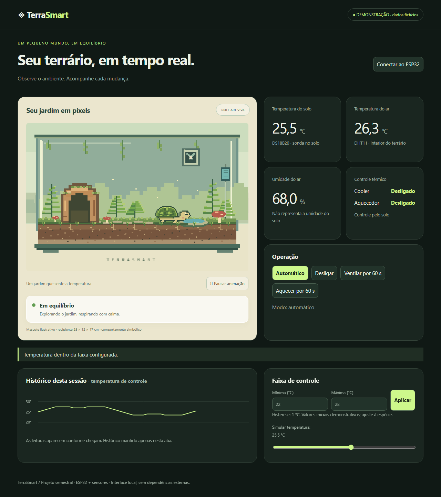

# TerraSmart — Terrário Inteligente

Monitoramento e controle automático de temperatura de um terrário com **ESP32**, sensor **DHT11** e um **cooler de 12 V** acionado por relé. O próprio ESP32 serve um painel web em pixel art, no qual uma tartaruga virtual reage às condições do terrário.



*Painel no modo demonstração (dados fictícios). Com o ESP32 ligado, os valores vêm dos sensores.*

Projeto desenvolvido como Trabalho Discente Efetivo (TDE) da disciplina **Conectividade em Sistemas Ciberfísicos**, do curso de Engenharia de Software da PUCPR (2026). O relatório técnico completo está em [`docs/relatorio_tecnico_terrasmart.pdf`](docs/relatorio_tecnico_terrasmart.pdf).

## Funcionalidades

- Leitura de temperatura e umidade do ar (DHT11) a cada 2,5 s.
- Controle automático do cooler com histerese de 1 °C e faixa de temperatura configurável pelo painel, salva na memória do ESP32.
- Comandos pelo painel: **Automático**, **Desligar**, **Ventilar por 60 s** e **Aquecer por 60 s** (este último só se houver aquecedor instalado).
- Painel web em HTML, CSS e JavaScript, sem bibliotecas externas, embutido no firmware. Tem gráfico do histórico e modo de demonstração.
- Operação segura: o cooler começa desligado. Depois de 3 falhas seguidas do sensor, as saídas são desligadas. Se a rede cair, o Wi-Fi reconecta a cada 10 s.

## Estrutura do repositório

```
firmware/terrasmart/terrasmart.ino     firmware + interface web (arquivo único)
docs/interface.png                     captura do painel (modo demonstração)
docs/relatorio_tecnico_terrasmart.pdf  relatório técnico final do TDE
```

## Hardware

| Componente | Pino do ESP32 |
|---|---|
| DHT11 VCC | D27 (o firmware coloca este pino em 3,3 V) |
| DHT11 DATA | D26 |
| DHT11 GND | GND |
| Relé S (sinal) | D25 |
| Relé + | VIN (5 V) |
| Relé − | GND |

**Cooler (12 V):** positivo da fonte no COM do relé, NO do relé no positivo do cooler, negativo do cooler no negativo da fonte.

O módulo relé usado foi o HW-482, que liga com sinal HIGH. Se o seu relé ligar quando deveria desligar, troque `ATUADOR_ATIVO_ALTO` para `false` no firmware.

## Como compilar e gravar

1. Instale a **Arduino IDE** e o pacote de placas **esp32** (Espressif). Selecione a placa **ESP32 Dev Module**.
2. Instale as bibliotecas **DHT sensor library** (Adafruit) e **Adafruit Unified Sensor**. Se for usar a sonda de solo, instale também **OneWire** e **DallasTemperature**.
3. No Windows, pode ser preciso instalar o driver **CP210x Universal** (Silicon Labs) para a porta serial aparecer.
4. Abra `firmware/terrasmart/terrasmart.ino` e preencha a sua rede Wi-Fi (2,4 GHz):

   ```cpp
   const char* ssid  = "NOME_DA_SUA_REDE";
   const char* senha = "SENHA_DA_SUA_REDE";
   ```

   > Não faça commit da sua senha real. O repositório guarda apenas esses valores de exemplo.

5. Grave o programa e abra o **Monitor Serial a 115200 baud**. Quando aparecer `Abra no navegador: http://<IP>`, acesse esse endereço em um aparelho da mesma rede.

### Opções no firmware

| Definição | Padrão | Para que serve |
|---|---|---|
| `AQUECEDOR_INSTALADO` | `0` | `1` habilita um aquecedor no pino D33 |
| `SONDA_SOLO_INSTALADA` | `0` | `1` habilita a sonda DS18B20 no pino D5, que passa a ser a referência do controle |
| `ATUADOR_ATIVO_ALTO` | `true` | nível lógico que liga o relé |

## API HTTP

| Método | Rota | Descrição |
|---|---|---|
| `GET` | `/` | painel TerraSmart |
| `GET` | `/temperatura` | leituras e estado completo em JSON (usado pelo painel) |
| `GET` | `/status` | JSON simples: `temperatura`, `umidade`, `atuador`, `sensorOk` |
| `POST` ou `GET` | `/atuador` | `mode=auto` \| `off` \| `cool` \| `heat` (aceita também `estado=on` \| `off`) |
| `POST` | `/config` | `min=..&max=..` define a faixa de controle (mínimo de 2 °C entre os limites) |

Exemplo:

```bash
curl http://<IP-do-ESP32>/status
# {"temperatura":25.0,"umidade":68.0,"atuador":"off","sensorOk":true}

curl -X POST -d "mode=cool" http://<IP-do-ESP32>/atuador
```

Sem leitura válida do sensor, todos os comandos, exceto `off`, respondem `409`. Parâmetros inválidos respondem `400`.

## Créditos

- **Interface web** (HTML, CSS, JavaScript e pixel art): Guilherme Hiuda. A equipe adaptou a interface à montagem, ajustando os pinos, o nível lógico do relé e os componentes instalados.
- **Firmware, montagem e relatório:** equipe do Terrário Inteligente (nomes no relatório técnico).
